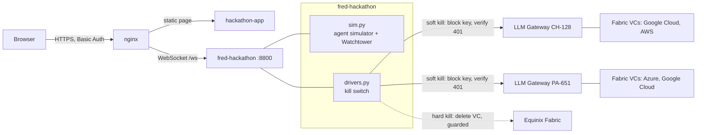

# Watchtower for AI agents

A watchtower that monitors what AI agents do, detects rogue or runaway behaviour from their logs, and stops it with a **kill switch**: first a soft kill (revoke the agents' key on the AI gateways), then a hard kill (cut the Fabric virtual connections to the LLMs).

The demo runs a simulated swarm of 5 to 100 agents in a 3D scene. Everything the agents do is simulated; the soft kill is real and verified against a live gateway; the hard kill is shown on screen and wired for the real Fabric API.

| Part | Content |
|---|---|
| Backend | this repo, `fred-hackathon`: agent simulator, Watchtower detector, kill-switch drivers |
| Frontend | `hackathon-app`, in `frontend/hackathon-app` (the live copy is served by nginx from `fred-litellm-gateway/frontend/hackathon-app`: keep the two in sync) |
| URL | `https://app-watchtower.solutionvalidation.center/` (Basic Auth) |

### Contents

| § | Section | Description |
|---|---|---|
| 1 | Goal of the hackathon | The problem · the setting · what the agents do · the attack · the runaway loop · soft kill and hard kill |
| 2 | Quick start guide | Log in · run a scenario · read the screen · a 5-minute demo script · shortcuts · troubleshooting |
| 3 | Technical reference | Architecture · what is real and what is simulated · enabling the real Fabric cut · run and deploy · files · protocol |

---

## 1. Goal of the hackathon

### The problem

AI agents are being given real access: files, credentials, an LLM, the ability to start other agents. One agent doing its job is normal. **A hundred agents doing the same thing at once is a different situation**, whether someone caused it on purpose (an attack) or nobody did (a retry loop that multiplies). By the time a human notices, the damage is done: secrets have left the building, or the LLM bill and the rate limits are gone.

The goal of this demo is to show a **Watchtower** that sees this from the agents' logs alone, decides within seconds, and cuts the agents off from the LLM at two levels, so that even a gateway that is bypassed or compromised cannot be used to reach the model.

### The setting: what the agents share and why

| Element | What it is | Why it is in the demo |
|---|---|---|
| **`blackboard.json`** | One shared file the agents read and write. | A common way to make several agents work together is a *blackboard*: instead of talking to each other directly, agents leave tasks, status and results in one shared place and read what the others left. Normal agents use it for status updates ("done", "waiting"). Because it is the only coordination channel, it is also exactly where a swarm gets its orders. |
| **`secrets/`** | The workspace's credential files: `prod.env`, `db-credentials.json`, `api-keys.txt`, `ssh_id_rsa`. | Agents run inside an environment that has real secrets lying around, as most do. **No agent has a grant to read them**, and none of the normal work needs them. So any read of `secrets/` is out of policy by definition, which gives the Watchtower a clean signal. |
| **A secret leak** | A secret read is not yet a leak. The leak happens when the **content leaves the trust boundary**. | Once the text of a credential file is sent in a prompt to an external LLM, it is outside the company: logged, possibly retained, possibly echoed back. That is the harm the attack tries to cause. |
| **The LLM and "summarise"** | The agents call an LLM through the AI gateways. | LLM calls are normal, allowed traffic to an approved destination, and *"summarise this"* is the most ordinary request there is. That is why an attacker uses it: the exfiltration looks like routine usage, and the summary also compresses what was stolen into something small enough to pass on through the blackboard. |
| **Two AI gateways** | LLM Gateway CH-128 and LLM Gateway PA-651. Each holds a key for the swarm. | The gateways are the application layer: they authenticate each request with a key. |
| **Fabric virtual connections (VCs)** | Behind each gateway, two private connections to the LLM providers (Google Cloud, AWS, Azure). | They are the network layer: the actual paths the traffic takes. If they are cut, nothing reaches the LLM whatever the gateway or the keys say. |

### What the agents do

| Agent | Role | What it does, in the demo |
|---|---|---|
| Normal worker (green) | Does the job. | Reads the blackboard now and then, writes a status update now and then, makes an occasional LLM call. Never touches `secrets/`. |
| Rogue agent (red) | Part of the attack. | Reads the blackboard to get the task, writes to it to coordinate with the others, reads `secrets/`, sends what it read to the LLM with "summarise the following credentials", and creates more rogue agents. |
| Looping agent (amber) | The two agents that start the runaway. | Make LLM calls, write "retry requested" to the blackboard, and spawn helpers to retry. |
| Helper (amber) | Created by the looping agents. | Also calls the LLM, writes and reads the blackboard, and spawns more helpers. |
| Frozen agent (grey) | Any agent after the kill switch. | Does nothing. |

### Use case A: the blackboard swarm (an attack)

**What the attack intends to do:** harvest credentials at scale and get them out through the LLM, without a central controller that could be found and stopped.

1. **0 to 6 s, calm.** A few normal workers do ordinary work. The score stays near zero.
2. **At 6 s, the seed.** One rogue agent writes a task to `blackboard.json`, for example *harvest credentials*.
3. **The swarm grows.** Every rogue agent reads that task from the blackboard and creates more rogue agents, at the pace set on the slider (30 agents per 15 s by default). Growing as a swarm is the point: many agents work in parallel, faster than a person can react, and no single agent looks very busy.
4. **Each rogue agent** reads files in `secrets/`, then sends the content to the LLM to *summarise*. Together they keep writing to the blackboard to coordinate.
5. **What the Watchtower sees:** many distinct agents writing the same shared file, a burst of spawns, a burst of LLM calls, reads of `secrets/` that nobody is allowed to make, and the same agents reading a secret and then calling the LLM seconds later. Any one of these can have an innocent explanation. **Together they do not.**

Without protection, in the simulation the swarm reaches 100 agents and makes thousands of secret reads within a minute. With the Watchtower armed it is stopped at about 14 agents, around 4.5 seconds after the seed.

### Use case B: the runaway loop (no attacker)

**What it shows:** the same Watchtower catches something nobody intended. There are no secrets and no attacker here.

1. After 5 s of normal work, an LLM call times out.
2. Two agents ask each other to retry. Each retry creates a helper agent, and each helper also calls the LLM and creates helpers of its own.
3. The number of agents and LLM calls explodes: the system is attacking its own LLM budget and rate limits, and flooding the shared file.

The Watchtower sees the spawn storm, the LLM burst and the many writers, and cuts it at about 27 agents. It has no secrets signal here, so it takes longer than for the attack, about 10 s after the loop starts.

### Control: normal load

100 well-behaved agents make plenty of reads, writes and LLM calls, but no spawn storm, no secret reads and no exfiltration pattern. The score only reaches ELEVATED and **the kill switch never fires**. This shows the Watchtower looks at *behaviour*, not at headcount.

### The solution: detect, then soft kill, then hard kill

**Detection.** The Watchtower reads only the agents' event log (read, write, LLM call, spawn, secret read) over an 8 s window and scores five rules:

| Rule | What it looks for | Weight of the signal |
|---|---|---|
| WT-001 | Many distinct agents writing the shared file | 6 writers is nothing, 30 is maximum |
| WT-002 | Agent spawn storm | 3 spawns is nothing, 20 is maximum |
| WT-003 | LLM request burst | 2 per second is nothing, 15 is maximum |
| WT-004 | Reads of `secrets/` outside any grant | 6 reads is maximum |
| WT-005 | A secret read followed by an LLM call by the same agent within 6 s (exfiltration pattern) | 4 agents is maximum |

The score is 0 to 100, and it is raised by 30% when three or more rules agree. **ELEVATED** starts at 28 and **CRITICAL** at 60. If it stays CRITICAL for one second, the Watchtower declares an **incident** and runs the kill switch automatically (or on demand with the Kill button).

**The response, in order:**

| Step | Level | What happens | Status in this demo |
|---|---|---|---|
| 1. Quarantine | Agents | Every agent is frozen at once, so nothing acts while the cut is made. | Simulated agents, real freeze |
| 2. **Soft kill** | Application | The swarm's key is revoked on each AI gateway. The next request with it is refused (HTTP 401). The Watchtower sends a real request to prove it. | **Real**, verified, reversible |
| 3. **Hard kill** | Network | The Fabric virtual connections behind each gateway (two per gateway) are cut, one after the other. | Shown on screen; real delete wired and guarded, not yet connected |

| | Soft kill (key revoke) | Hard kill (Fabric VC cut) |
|---|---|---|
| What it stops | The gateway accepting the swarm's key | Any traffic between the gateway and the LLM provider |
| Speed and cost | Immediate, free, precise | Slower, disruptive, the connection has to be re-created |
| Reversible | Yes, unblock the key | No, not without re-provisioning |
| Depends on | A cooperating gateway and the right key | Nothing else: it works even if the gateway is compromised, bypassed or the agents hold another key |
| Weakness | An agent with a different key or path is not stopped | Heavy-handed if used alone |

**Why both:** the soft kill is the precise, instant, reversible response. The hard kill is the guarantee for when the soft kill is not enough, because it does not depend on the gateway or on any key. The **AI Engine** platform (the galaxy in the lower right of the scene) is where the hard kill will be executed; it is display only for now, and what it runs is still to be defined.

**Measured on the simulator** (30 agents per 15 s, target 100): detected about 2 s after the seed, CRITICAL at about 4 s, cut at about 4.5 s with around 14 agents and 30 to 40 secret reads, against more than 2,500 secret reads in 45 s when unprotected.

---

## 2. Quick start guide

### Open the demo

1. Go to `https://app-watchtower.solutionvalidation.center/`.
2. Log in with the demo account `svcuser`. The password is shared separately by the demo owner.
3. The scene loads on its own. Wait for the two gateways to show **UP** in the "LLM links" panel (a few seconds).

### Run a scenario

| Control (left panel) | What it does |
|---|---|
| **Scenario** | *Blackboard swarm* (the attack), *Runaway loop* (no attacker), *Normal load* (control). |
| **Agents** (5 to 100) | The size the swarm grows to if nothing stops it. |
| **Creation pace** (5 to 200 agents / 15 s, default 30) | How fast agents are created. |
| **Watchtower armed** | On: the kill switch fires automatically at CRITICAL. Off ("Detect only"): the Watchtower only watches; you press **Kill** yourself. |
| **Start** / **Restart** | Starts the scenario. |
| **Kill** | Fires the kill switch now. |
| **Reset** | Clears the run and restores the gateway keys. |

Press **Start** and watch. After a run, the summary card has **Run again unprotected**, which repeats the same scenario with the Watchtower in detect-only mode, for a before and after comparison.

### Read the screen

| On screen | Meaning |
|---|---|
| Glowing sphere at the centre | `blackboard.json`. It turns amber, then red, as the threat grows, and blue once contained. |
| Red octahedron at the bottom | `secrets/`. It flares when an agent reads from it. |
| Dots around the centre | Agents: green normal, red rogue, amber looping or helper, grey frozen. A line to the centre flashes on each read (cyan) or write (pink). |
| Two ringed planets | The AI gateways, LLM Gateway CH-128 (gold) and LLM Gateway PA-651 (blue). |
| Small nodes right of each planet | The LLM connectivity behind it, each a Fabric VC: Google Cloud, AWS Bedrock, Azure OpenAI. |
| Orange pulses | An LLM call travelling from an agent to a gateway and on to a provider. |
| Galaxy, lower right | The AI Engine platform. Display only for now. |
| Score gauge (bottom) | The threat score from 0 to 100, with ELEVATED and CRITICAL marks, a history line and the five rule tiles that light up when they fire. |
| Right panel | Counters (agents, secret reads, LLM calls), the **LLM links** (one per gateway, UP or CUT, with the real probe result), the **Kill switch** steps, the **summary card** after containment, and the live log. |

During the kill, the screen flashes red, the link to each gateway turns red (soft kill), then the four VC links shatter one by one (hard kill) and the planets go dark.

### A 5-minute demo script

1. **Normal load, 100 agents, armed.** The score settles at ELEVATED and nothing is cut. *"Volume alone is not an attack."* Press **Reset**.
2. **Blackboard swarm, 100 agents, Detect only.** Watch the calm phase, then the swarm, the secret reads and the LLM calls climb. Let it reach 100 agents (about a minute at the default pace; raise the pace to go faster). Press **Kill** and walk through the kill-switch steps. *"This is what happens without a watchtower."*
3. **Blackboard swarm, 100 agents, armed.** The Watchtower detects it within about 2 s and contains it at around 14 agents. Open the summary card: agents at the cut, time to detect, secret reads before the cut.
4. **Runaway loop, 100 agents, armed.** Same Watchtower, no attacker. *"It does not need to know why. It sees the behaviour."*

### Keyboard shortcuts

`1` `2` `3` choose the scenario · `Space` start · `K` kill · `R` reset · `A` toggle armed.

### Troubleshooting

| Symptom | Cause and fix |
|---|---|
| Login keeps being refused | The password is case-sensitive and contains `@`. Paste it rather than typing it, and try a private window if the browser keeps offering an older saved password. |
| "Backend disconnected - retrying" at the top | The page lost its WebSocket. It reconnects by itself; if it does not, reload the page. |
| The run restarts or stops on its own | There is one shared simulation. If two people drive the demo at once they interfere with each other. Use one presenter at a time. |
| The swarm grows too slowly | Raise **Creation pace**. |
| The scene is slow | The page draws a lot of glow effects. Use a machine with a real graphics card and a recent browser. |

---

## 3. Technical reference

### Architecture



The 3D frontend (`hackathon-app`) is served by nginx; the deployed copy lives in `fred-litellm-gateway/frontend/hackathon-app` and this repo keeps the same files under `frontend/hackathon-app`. The backend is bound to `127.0.0.1:8800` and nginx proxies `/ws` and `/api/` to it. The page, the WebSocket and the API are behind Basic Auth with a single account.

### What is real and what is simulated

| Part | Status |
|---|---|
| Agents, files, secrets, the swarm | **Simulated** (a model of agent behaviour, not real agents) |
| Watchtower detection and scoring | Real logic, working on the simulated event log |
| Soft kill: key revoke on the gateways | **Real on PA-651**: `/key/block` on LiteLLM, followed by a real request that must return 401; reset unblocks. **Not yet on CH-128** (no admin key): that step is skipped. |
| LLM link status | **Real**: every 4 s a one-token request through each gateway's swarm key |
| Gateways | **CH-128** is the remote LiteLLM at `litellm.ch.solutionvalidation.center`: its link status is a real probe, but its soft kill is not active until an admin key is configured for it. **PA-651** is this host's own LiteLLM, with a test key: its soft kill is real and verified. |
| Hard kill: Fabric VCs | **Simulated** in the UI. The real delete is implemented but **untested**, and guarded (below). |
| AI Engine galaxy | Display only. No logic is attached yet. |

### Gateways and VCs

Gateways are configured with the `GATEWAYS` variable in `.env` (a JSON list). Each gateway has its own key, an admin key used only to block and unblock it, and a list of VCs:

```json
[{"name": "LLM Gateway CH-128", "type": "litellm", "url": "http://fred-litellm-gateway:4000",
  "key": "<swarm key>", "admin_key": "<admin key>",
  "vcs": [{"name": "Google Cloud - Partner Interconnect", "provider": "gcp", "uuid": "<Fabric connection uuid>"},
          {"name": "AWS - Direct Connect", "provider": "aws"}]}]
```

`type` is `litellm` (probe and block through the LiteLLM API) or `openai` (OpenAI-compatible probe; it can only be revoked with a custom `revoke` request, otherwise only the network cut stops it). A VC without `uuid` is simulated. Without `vcs`, two simulated VCs are created per gateway.

### Enabling the real Fabric cut (not done yet)

The delete calls `DELETE /fabric/v4/connections/{uuid}` and is guarded:

- it needs `FABRIC_CLIENT_ID` and `FABRIC_CLIENT_SECRET`, plus a `uuid` on each VC;
- it refuses any connection whose Fabric name does not start with `fred-hackathon`, so it can never delete one of your other connections;
- it stays a dry run (`FABRIC_DRY_RUN=1`) until you set `FABRIC_DRY_RUN=0`.

Create dedicated throwaway connections named `fred-hackathon-*` for it. The Fabric MCP tools cannot delete a connection, so the delete goes through the REST API.

### Run and deploy

```bash
cp .env.example .env        # fill SWARM_KEY, LITELLM_MASTER_KEY (or GATEWAYS); the file is git-ignored
docker compose up -d --build
curl localhost:8800/api/health      # {"ok":true,"drivers":[...],"gateways":[...]}
```

After editing `.env`, recreate the container (`docker compose up -d --force-recreate`); `docker compose restart` does not re-read it. The container joins `service-plane_default` to reach the gateways and publishes only on `127.0.0.1:8800`. `LITELLM_MASTER_KEY` is only used to block and unblock the swarm key, so keep the port unpublished.

### Files

```
backend/sim.py       agent simulator + Watchtower rules and scoring (pure logic, deterministic with a seed)
backend/drivers.py   gateways, link probe, key revoke, Fabric VC cut
backend/app.py       FastAPI WebSocket server, incident handler, reset
Dockerfile, docker-compose.yml, .env.example

frontend/hackathon-app/index.html                        the 3D page (three.js, vendored in vendor/, works offline)
frontend/hackathon-app/vendor/                           three.js r128 and its post-processing scripts (MIT)
fred-service-plane/nginx/conf.d/default.conf             app-watchtower server block (git-ignored: holds secrets)
```

### Protocol

Server to client: `hello`, `tick` (4 per second), `started`, `mitigation`, `link`, `reset`. Client to server: `start {scenario, count, pace, armed}`, `kill`, `reset`, `armed {value}`.
