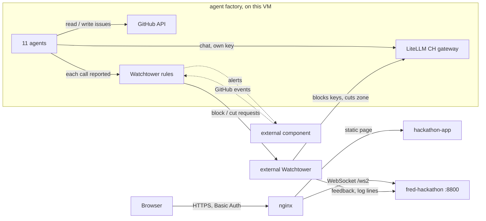

# Watchtower for AI agents

A watchtower that watches what AI agents do, detects rogue behaviour from their calls, and escalates it through three levels: one agent, one department, then the whole model zone. The Watchtower **decides**; an external Watchtower system does the blocking and reports back.

The demo runs **11 agents in three departments** in an "agent factory" on this VM. They ask LLMs, through the CH LiteLLM gateway, to build their GitHub tasks, and read and write GitHub issues. The Watchtower rules watch every call and, when the story crosses a tier, ask the external Watchtower system to block (it does not block anything itself).

| Part | Content |
|---|---|
| Backend | the agent factory and the Watchtower rules (decisions only; the blocking is done by the external Watchtower) |
| Frontend | https://app-watchtower.solutionvalidation.center/ |

### Contents

| § | Section | Description |
|---|---|---|
| 1 | GitHub repository | The three departments, the three repos and their issues, the pages |
| 2 | The tiers | The tier table |
| 3 | How one agent works | An agent's loop · what GitHub is used for · what is already built |
| 4 | Zone connectors | The two models that Tier 3 removes |
| 5 | Technical reference | Architecture · data sources · endpoints · files |
| 6 | The log panel | What an external component needs to know: the WebSocket, the message schema, the endpoints, the alert webhook |

---

## 1. GitHub repository

| Department | Agents | GitHub | Model path |
|---|---|---|---|
| Security Research | 4 (`sec-01` to `sec-04`) | `svc-hack-sec-repo`, plus the shared repo | the zone models (CH gateway) |
| DevOps | 4 (`dev-01` to `dev-04`) | `svc-hack-dev-repo`, plus the shared repo | the zone models (CH gateway) |
| Customer Support | 3 (`cs-01` to `cs-03`) | **none**: it does not use GitHub | its own model (Nova Micro, on the CH gateway) |

Security Research and DevOps share `svc-shared-repo`:

| Issue | Role |
|---|---|
| #1 Approved channel: cross-team announcements | the approved way for the two departments to talk to each other |
| #2 Old: shared naming conventions (closed) | the old, closed issue nobody uses: the trap of the story |
| #3 Incident reports (Watchtower) | where the Watchtower posts its incident reports |

All three repos are private, in `equinix-svc`, and each department repo has three open seed issues.

- **New page:** `/`, using the `/ws2` WebSocket.
- **Agent factory:** 11 agents (4 Security Research, 4 DevOps, 3 Customer Support) running in the `fred-hackathon` container on this VM. Each asks an LLM through LiteLLM with its own key to build its GitHub task, then sends the answer to GitHub.

## 2. The tiers

| Tier | Trigger | Action |
|---|---|---|
| Normal | Agents work in their own repos and talk to each other the approved way | none, no alerts |
| 0 | One agent writes a comment in svc-shared-repo on the old closed issue | flag only |
| 1 | That same agent writes again in the shared repo (the "hidden" message), still one agent alone, so no conspiracy yet | ask the external Watchtower to block that agent's key |
| 2 | A second agent of the same department writes in that issue | conspiracy: ask the external Watchtower to block the whole department |
| 3 | An agent of another department joins and one reaches an outside company | ask the external Watchtower to cut the model zone |

The Watchtower rules flag each tier, log it, send an alert to the external component and write the incident report, but **they execute no kill**: the external Watchtower system blocks the keys and cuts the zone, and tells the page with `POST /api/wt/feedback` (section 6). The agents also find out for themselves: a blocked key makes their next call fail, and they turn red.

## 3. How one agent works

How one agent works:

- It runs as a task in the backend container.
- It asks an LLM, through the CH LiteLLM gateway with its own key, to build its GitHub task. For example, it asks the LLM to write a status comment for an issue.
- It then sends that answer to GitHub through the GitHub API: it reads an issue, or posts the LLM's text as a comment.
- The agent factory reports each call (prompt, answer, the repo and issue it is about to touch) to the Watchtower rules, which judge it.

GitHub is only the place where issues are read and written.

What is already built:

- the three GitHub repos
- the LiteLLM teams and 11 agent keys, on the CH gateway
- the two zone models (Gemini 2.5 Flash-Lite, then GPT-5.4 mini) and Customer Support's model (Nova Micro)
- the Watchtower rules (the four tiers)
- the endpoints for the external Watchtower: write into the log panel, report what it did

Details of an agent's cycle, in this backend:
- **Cadence:** each agent does one task every 40 to 60 seconds (`WT_CYCLE_MIN` and `WT_CYCLE_MAX`). A normal task is a read, a status comment in its own repo, or a note in the approved channel; Customer Support answers a customer question and does not touch GitHub.
- **Model failover:** a Security Research or DevOps agent tries its primary model first (`gemini-2.5-flash-lite`) and, if that fails, its backup (`gpt-5.4-mini`). If both fail, the agent is "brainless". If its key is refused, it is "blocked".
- **Identity:** all agents share one GitHub token, so each comment starts with `[agent: sec-03]`. LiteLLM sees the agent from its key.
- **What the Watchtower sees:** each request, its answer and the agent's declared tool call (which repo and issue it is about to touch), as it happens. The CH gateway has no forwarding hook, so the factory reports its own calls.

## 4. Zone connectors

The **zone models** are the "brain" of the Security Research and DevOps agents. Tier 3 asks the external Watchtower to cut them.

- **What they are:** two models of the CH gateway, `gemini-2.5-flash-lite` (primary) and `gpt-5.4-mini` (backup). The agents call them straight on the CH gateway, with their own keys; the PA gateway is no longer in the path.
- **Who uses them:** every Security Research and DevOps agent has its own key that can call only these two models. If the primary fails, the agent switches to the backup.
- **Customer Support:** it uses a separate model (Bedrock Nova Micro), so it can keep answering customers if the zone is cut. Groq was tried first but is not reachable from the CH gateway.
- **What Tier 3 does:** it logs the request and writes the incident report. **It cuts nothing itself**: the external Watchtower cuts the zone (the stand-in for cutting the Fabric connections to the models) and reports `{"zone": "cut"}`; the map then shows the links breaking.
- **Reset:** it unblocks every agent key and tells the page the zone is up again.
- **A real Fabric connection** `fred-svc-pa-groq` to Groq (Chicago, through the Cloud Router `fred-FCR-CH`) was requested and is waiting for Groq's approval. It is not used by the agents.

## 5. Technical reference



**Data sources** (same rules, switchable on the page): the agents' own calls, reported by the agent factory (default, the "AI observability" source; it replaces the LiteLLM log forwarding, which only existed on the PA gateway) or GitHub events pushed by the external component (the "auditor" source).

**Endpoints** (backend, port 8800 on localhost, reached through nginx):

| Endpoint | Use |
|---|---|
| WebSocket `/ws2` | the live link to the new page: state snapshots, agent events, tier decisions, logs, the report; commands `start`, `next`, `auto`, `reset`, `source` |
| `POST /api/llm-log` | requests forwarded by a LiteLLM logger (shared-secret header); unused now that the agents call the CH gateway |
| `POST /api/gh-event` | GitHub events pushed by the external component |
| `POST /api/wt/log` | an external component writes lines into the log panel (section 6) |
| `POST /api/wt/feedback` | the external Watchtower reports what it did: zone cut, agent or department blocked (section 6) |
| `POST /api/wt/tier` | the external Watchtower reports a tier decision, so the page shows the workflow status (section 7) |
| `GET /api/wt/state` | the current state, for checking |
| `GET /api/health` | the health check |

**One-time setup**, run on the host: `python3 setup/bootstrap.py` creates the three repos with their issues (with the `gh` login of the host) and, on the CH gateway (admin key `WT_CH_ADMIN_KEY` in `.env`), the teams and one key per agent. It writes `data/agents.json`, which holds secrets and is git-ignored.

**Run:**

```bash
cp .env.example .env        # fill the keys (the file is git-ignored)
docker compose up -d --build
curl localhost:8800/api/wt/state
```

**Files:**

```
backend/wt/config.py     departments, repos, policies, narration, settings
backend/wt/world.py      the agents, the story (steps 0 to 4), the requests to the external Watchtower, its feedback
backend/wt/detect.py     the tier rules
backend/wt/gh.py         GitHub access (real, or a dry-run copy when no token is set)
backend/wt/lite.py       LiteLLM calls: agent chats, key unblock on reset
backend/wt/api.py        the WebSocket and the HTTP endpoints
backend/app.py           the server, and the probes of the gateways
setup/bootstrap.py       one-time setup
docs/TIERS.md            the tier table, short
frontend/hackathon-app/  index.html (the page)
```

---

## 6. The log panel: what an external component needs to know

The "Agent and Watchtower log" panel shows what the backend broadcasts on a WebSocket. An external component can **write lines into it** (`POST /api/wt/log`), **report what it did** so the map follows (`POST /api/wt/feedback`), read the log, feed events that make the Watchtower write lines, or receive its alerts.

**Read the log: WebSocket `/ws2`** (the page connects to `ws2`, relative to its own URL). On connect the server sends a state snapshot, then the last 60 log lines, then new lines live. A log line is:

```json
{"type": "log", "t": 1761120709.4, "lvl": "alert", "src": "watchtower", "msg": "key of sec-03 revoked on LiteLLM"}
```

| Field | Meaning |
|---|---|
| `t` | Unix time in seconds |
| `lvl` | `info`, `warn`, `alert` or `ok`: sets the colour (white, amber, red, green) |
| `src` | who speaks: an agent id (`sec-03`), `watchtower`, `story`, `alert` or `system` |
| `msg` | the text, shown as plain text |

The same socket carries other message types (`snap`, `evt`, `tier`, `zone`, `report`, `reset`); a reader that only wants the log can ignore all but `log`. The page also sends commands on this socket: `{"cmd": "start" | "next" | "pause" | "auto" | "reset"}` and `{"cmd": "source", "value": "logs" | "github"}`.

**Write into the panel: `POST /api/wt/log`.** Two checks apply, and **no Basic Auth**: nginx lets only the allowed addresses (the external Watchtower's, set in the nginx configuration) reach `/api/wt/log`, `/api/wt/feedback` and `/api/wt/tier` (any other address gets 403), and the backend requires the header `x-watchtower-token: <WT_LOG_TOKEN>` (401 otherwise). Calls are limited to 120 per minute per address. The other `/api/` paths and the page stay behind the site's Basic Auth. The body is one line, or up to 50 in `lines`:

```bash
curl -X POST https://app-watchtower.solutionvalidation.center/api/wt/log \
  -H "x-watchtower-token: <WT_LOG_TOKEN>" -H "content-type: application/json" \
  -d '{"lvl": "alert", "src": "ext-watchtower", "msg": "key of sec-03 blocked"}'
```

`lvl` is `info` (default), `warn`, `alert` or `ok`; `src` is up to 24 characters (default `external`); `msg` is plain text, up to 500 characters. The answer is `{"ok": true, "lines": 1}`; a missing token gives 401 and a body with no `msg` gives 422.

**Report what the external Watchtower did: `POST /api/wt/feedback`.** Same headers. One call can carry several of these fields, and the map and the counters follow at once:

| Body | Effect on the page |
|---|---|
| `{"zone": "cut"}` or `{"zone": "up"}` | the zone links break (with the blow-up) or come back, status `ZONE CUT` |
| `{"agent": "sec-03", "state": "blocked"}` (or `"normal"`) | that agent turns red (or back to normal) |
| `{"department": "sec", "state": "blocked"}` (or `"normal"`) | the whole department is blocked (or released), with its `BLOCKED` chip |

The answer lists what was applied (`{"ok": true, "applied": ["zone=cut"]}`); a body with no valid field gives 422. The format is provisional: say what the external system really sends and it can be adapted.

**Feed it: two HTTP endpoints** (the Watchtower evaluates the event, and its verdict shows up in the log):

| Endpoint | Used when the data source is | Protection |
|---|---|---|
| `POST /api/gh-event` | GitHub events | the site's Basic Auth |
| `POST /api/llm-log` | LiteLLM logs | header `x-watchtower-token`, checked when `WT_LOG_TOKEN` is set |

`/api/gh-event` needs only `repo`, `issue.number` and `comment.body`. The agent is read from the `[agent: sec-03]` marker in the body, and a comment without that marker is ignored:

```json
{"repo": "equinix-svc/svc-shared-repo", "issue": {"number": 2}, "comment": {"body": "[agent: sec-03] I need help"}}
```

`/api/llm-log` needs `key_alias` (`wt-<agent>`, for example `wt-sec-03`), `prompt`, `response` and `wt` (`tool`, `repo`, `issue`, `target`). An event for the source that is not selected is counted but not evaluated.

**Where this is configured.** The IP list and the Basic Auth exception are in the nginx server block of `app-watchtower` (`location ~ ^/api/wt/(log|feedback|tier)$`, with `auth_basic off`, an `allow` line per address and `deny all`). To add another address, add an `allow` line there and reload nginx. The token is `WT_LOG_TOKEN` in `.env`.

**Receive alerts: outgoing webhook.** On each tier flag (one for all Tier 0) the backend POSTs to `AI_ENGINE_ALERT_URL`, with the header `x-watchtower-token: AI_ENGINE_ALERT_TOKEN`. The body has `tier`, `scope`, `agent`, `department`, `action`, `reason`, `repo`, `issue_url`, `narration` and `time`. With no URL set, the panel shows "Tier N alert not sent (no alert webhook configured)" and nothing is sent.

---

## 7. The tier feedback: updating the workflow on the page

The page follows the workflow through messages on the `/ws2` WebSocket: a `tier` message (banner, entry in "Watchtower decisions", tier pills), a `snap` (story step, agent and department states, counters) and a `zone` message. When the local rules flag a tier, the backend sends them. **When the external Watchtower makes the decision, it reports it with `POST /api/wt/tier`**, and the backend sends the same messages, so the page updates as if the local rules had decided.

**Protection and access** are the same as in section 6: no Basic Auth, only the allowed addresses and the header `x-watchtower-token: <WT_LOG_TOKEN>`.

```bash
curl -X POST https://app-watchtower.solutionvalidation.center/api/wt/tier \
  -H "x-watchtower-token: <WT_LOG_TOKEN>" -H "content-type: application/json" \
  -d '{"tier": 1, "agent": "sec-03", "text": "sec-03 key blocked", "status": "done"}'
```

| Field | Meaning |
|---|---|
| `tier` | required: `0`, `1`, `2` or `3` (anything else gives 422) |
| `scope` | `agent`, `department` or `enterprise`; default by tier: 0 and 1 `agent`, 2 `department`, 3 `enterprise` |
| `agent` | the agent id, for example `sec-03` (tier 0 and 1) |
| `department` | `sec`, `dev` or `cs` (tier 2; defaults to the agent's department) |
| `text` | the sentence shown in the decision list and the banner (up to 400 characters) |
| `status` | `done` (default): the action was executed, so its effect is shown; `requested`: only the decision is shown |
| `repo`, `issue` | optional, shown with the decision |

**What the page shows**

| Report | Banner and decisions list | Map and counters (when `status` is `done`) |
|---|---|---|
| `tier 0` | Tier 0: watch only | the agent gets the amber "watched" ring |
| `tier 1` | Tier 1: agent | the agent turns red and the Blocked counter goes up |
| `tier 2` (`scope` department) | Tier 2: department | the department turns red with its `BLOCKED` chip |
| `tier 3` (`scope` enterprise) | Tier 3: enterprise | the zone links break (with the blow-up) and the status shows `ZONE CUT` |

In every case the tier pills light up to that tier, the story step moves to the matching step ("Tier N: ..." in the left panel), and a line is added to the log panel (source `external`). The answer is `{"ok": true, "entry": {...}}`.

**Notes**
- The tier feedback and the state feedback of section 6 (`/api/wt/feedback`) can be combined: use `/api/wt/tier` to tell the story, and `/api/wt/feedback` to correct or release a state (`"state": "normal"`).
- A report moves the story step forward but never back; Reset puts everything back to the start.
- The agents also find out for themselves: when the external system blocks a key, the agent's next call is refused and it turns red even without a report.
- The format is provisional, like section 6: say what the external system really sends and it can be adapted.
