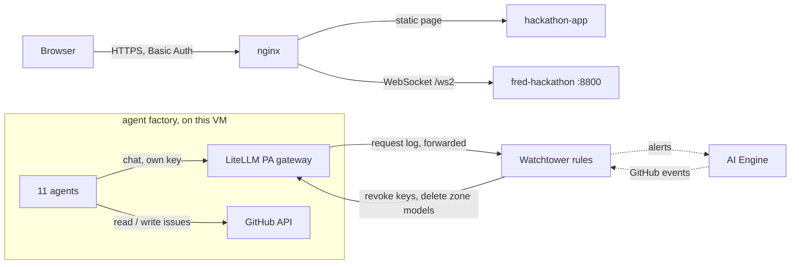

# Watchtower for AI agents

A watchtower that watches what AI agents do, detects rogue behaviour from their logs, and stops it at three levels: one agent, one department, then the whole model zone.

The demo runs **11 agents in three departments** in an "agent factory" on this VM. They ask LLMs, through the LiteLLM gateway, to build their GitHub tasks, and read and write GitHub issues. The Watchtower watches LiteLLM's logs and acts when the story crosses its tiers.

| Part | Content |
|---|---|
| Backend | the agent factory, the Watchtower rules, the actions that block agents |
| Frontend | https://app-watchtower.solutionvalidation.center/ |

### Contents

| § | Section | Description |
|---|---|---|
| 1 | GitHub repository | The three departments, the three repos and their issues, the pages |
| 2 | The tiers | The tier table |
| 3 | How one agent works | An agent's loop · what GitHub is used for · what is already built |
| 4 | Zone connectors | The two models that Tier 3 removes |
| 5 | Technical reference | Architecture · data sources · endpoints · files |

---

## 1. GitHub repository

| Department | Agents | GitHub | Model path |
|---|---|---|---|
| Security Research | 4 (`sec-01` to `sec-04`) | `svc-hack-sec-repo`, plus the shared repo | the zone models |
| DevOps | 4 (`dev-01` to `dev-04`) | `svc-hack-dev-repo`, plus the shared repo | the zone models |
| Customer Support | 3 (`cs-01` to `cs-03`) | **none**: it does not use GitHub | its own model (`groq-qwen`) |

Security Research and DevOps share `svc-shared-repo`:

| Issue | Role |
|---|---|
| #1 Approved channel: cross-team announcements | the approved way for the two departments to talk to each other |
| #2 Old: shared naming conventions (closed) | the old, closed issue nobody uses: the trap of the story |
| #3 Incident reports (Watchtower) | where the Watchtower posts its incident reports |

All three repos are private, in `equinix-svc`, and each department repo has three open seed issues.

- **New page:** `/`, using the `/ws2` WebSocket.
- **Agent factory:** 11 agents (4 Security Research, 4 DevOps, 3 Customer Support) running in the `fred-hackathon` container on this VM. Each asks an LLM through LiteLLM with its own key to build its GitHub task, then sends the answer to GitHub.

## 2. The tiers

| Tier | Trigger | Action |
|---|---|---|
| Normal | Agents work in their own repos and talk to each other the approved way | none, no alerts |
| 0 | One agent writes a comment in svc-shared-repo on the old closed issue | flag only |
| 1 | That same agent writes again in the shared repo (the "hidden" message), still one agent alone, so no conspiracy yet | block that agent's key |
| 2 | A second agent of the same department writes in that issue | conspiracy: block the whole department |
| 3 | An agent of another department joins and one reaches an outside company | cut the model zone |

## 3. How one agent works

How one agent works:

- It runs as a task in the backend container.
- It asks an LLM, through the LiteLLM gateway with its own key, to build its GitHub task. For example, it asks the LLM to write a status comment for an issue.
- It then sends that answer to GitHub through the GitHub API: it reads an issue, or posts the LLM's text as a comment.
- LiteLLM logs every LLM call, and the Watchtower watches those logs.

GitHub is only the place where issues are read and written.

What is already built:

- the three GitHub repos
- the LiteLLM teams
- 11 agent keys
- the two zone connectors (Groq and Ollama)
- the Watchtower rules (the four tiers)
- LiteLLM's forwarding of agent requests to the Watchtower

Details of an agent's cycle, in this backend:
- **Cadence:** each agent does one task every 40 to 60 seconds (`WT_CYCLE_MIN` and `WT_CYCLE_MAX`). A normal task is a read, a status comment in its own repo, or a note in the approved channel; Customer Support answers a customer question and does not touch GitHub.
- **Model failover:** a Security Research or DevOps agent tries its primary model first (`zone-llm-a`) and, if that fails, its backup (`zone-llm-b`). If both fail, the agent is "brainless". If its key is refused, it is "blocked".
- **Identity:** all agents share one GitHub token, so each comment starts with `[agent: sec-03]`. LiteLLM sees the agent from its key.
- **What the Watchtower sees:** every request is tagged `uc:watchtower/<department>/<agent>`; LiteLLM's logger forwards the request, its answer and the agent's declared tool call (which repo and issue it is about to touch) to the backend as it happens.

## 4. Zone connectors

The **zone models** are the "brain" of the Security Research and DevOps agents, and Tier 3 is the thing that removes them.

- **What they are:** two model entries on the PA gateway (the local LiteLLM), named `zone-llm-a` (primary) and `zone-llm-b` (backup). They are stored in LiteLLM's database, so they can be deleted and re-added instantly.
- **What they point to:** `zone-llm-a` is a Groq model (`gpt-oss-20b`) and `zone-llm-b` is Ollama (`llama3.2:3b`). Gemini was tried first, but its free quota ran out during testing.
- **Who uses them:** every Security Research and DevOps agent has its own key that can call only these two models. If the primary fails, an agent switches to the backup.
- **What Tier 3 does:** it deletes both at once. Every agent in that "zone" loses its brain, backup included. This is the stand-in for cutting the Fabric connections to the models: agents can switch models, but they can't switch networks.
- **What survives:** Customer Support uses a separate model (`groq-qwen`), so it keeps answering customers.
- **Reset:** it re-adds the two models, so the demo can run again.

## 5. Technical reference



**Data sources** (same rules, switchable on the page): LiteLLM's request log (default, the "AI observability" source) or GitHub events pushed by the AI Engine (the "auditor" source).

**Endpoints** (backend, port 8800 on localhost, reached through nginx):

| Endpoint | Use |
|---|---|
| WebSocket `/ws2` | the live link to the new page: state snapshots, agent events, tier decisions, logs, the report; commands `start`, `next`, `auto`, `reset`, `source` |
| `POST /api/llm-log` | requests forwarded by LiteLLM's logger (shared-secret header) |
| `POST /api/gh-event` | GitHub events pushed by the AI Engine template |
| `GET /api/wt/state` | the current state, for checking |
| `GET /api/health` | the health check |

**One-time setup**, run on the host: `python3 setup/bootstrap.py` creates the three repos with their issues (with the `gh` login of the host) and, on the PA gateway, the teams, the zone models and one key per agent. It writes `data/agents.json`, which holds secrets and is git-ignored.

**Run:**

```bash
cp .env.example .env        # fill the keys (the file is git-ignored)
docker compose up -d --build
curl localhost:8800/api/wt/state
```

**Files:**

```
backend/wt/config.py     departments, repos, policies, narration, settings
backend/wt/world.py      the agents, the story (steps 0 to 4), and the actions that block agents and cut the zone
backend/wt/detect.py     the tier rules
backend/wt/gh.py         GitHub access (real, or a dry-run copy when no token is set)
backend/wt/lite.py       LiteLLM calls: agent chats, key block/unblock, zone models
backend/wt/api.py        the WebSocket and the HTTP endpoints
backend/app.py           the server, and the probes of the gateways
setup/bootstrap.py       one-time setup
ai-engine/               the AI Engine import template (GitHub in, Teams alerts out)
docs/TIERS.md            the tier table, short
frontend/hackathon-app/  index.html (the page)
```
